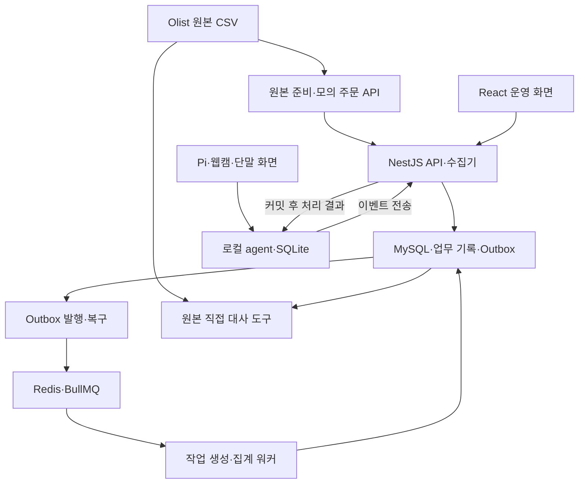
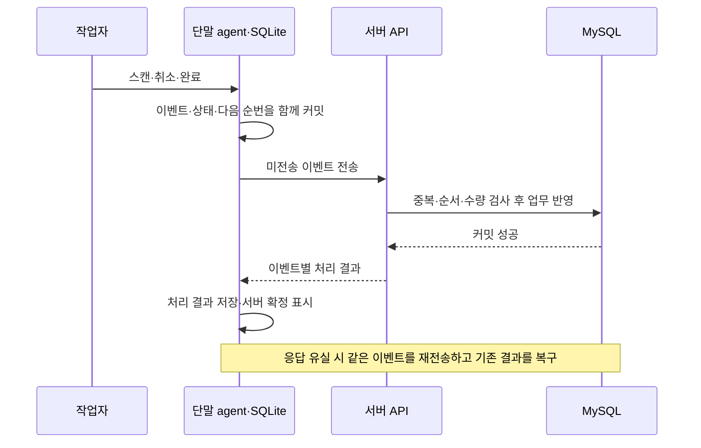

# 물류 운영 자동화 시스템

실제 주문을 수집해 출고 작업을 만들고, 통신 장애 중에도 현장 스캔 기록을 보존하는 시스템입니다. 연결이 복구되면 미전송 기록을 서버에 반영하며, 재전송으로 같은 작업이 중복 반영되지 않도록 설계했습니다.

## 해결하려는 문제

창고에서 상품을 스캔하는 중 서버 연결이 끊기면 작업을 멈추거나 기록을 나중에 다시 입력해야 할 수 있습니다. 단말에 기록을 남겨도 서버 응답이 유실되면 이미 처리된 내용을 다시 보내게 됩니다.

이 프로젝트는 다음 세 가지를 목표로 구현했습니다.

- 실제 주문의 상품·판매자 관계와 예외를 반영해 출고 작업을 자동 생성합니다.
- 이미 배정받은 작업은 오프라인에서도 스캔·취소·완료할 수 있게 합니다.
- 단말 재시작과 재전송 이후에도 기록과 수량을 복구하고, 서버의 중복 반영을 막습니다.

Olist의 실제 과거 주문 데이터를 사용했습니다. 출고 작업·배정·QR·스캔과 장애 시나리오는 프로젝트에서 생성했습니다. 실제 재고 확보나 택배 발송을 수행하는 시스템은 아닙니다.

## 주요 기능

| 기능 | 구현 내용 |
| --- | --- |
| 주문 수집·분류 | 모의 외부 REST API의 페이지 수집, 원본 보존, 체크포인트 재개, 보류·미지원 사유 관리 |
| 출고 작업 생성 | 적격 주문별 작업 생성, 상품별 필요 수량 집계, 수동 최초 배정 |
| 현장 입력 | QR 스캔, 잘못된 상품·초과 수량 차단, 특정 스캔 취소, 수량 일치 시 완료 |
| 오프라인 보존 | SQLite에 이벤트와 상태를 함께 기록하고, 재시작 시 복구 |
| 서버 동기화 | 이벤트별 중복·순서·소유권 검사, DB 커밋 후 응답, 부분 성공과 재시도 처리 |
| 후속 작업 복구 | MySQL Outbox와 Redis·BullMQ를 이용한 작업 생성·집계 및 전달 실패 복구 |
| 운영 화면 | 주문·작업·이벤트 조회, 배정, 실패 job 재시도, 메모·감사 기록, 확정 기준 집계·CSV |

## 시스템 구성

API와 워커는 같은 도메인 코드와 MySQL을 사용하는 별도 프로세스입니다. 단말 화면은 로컬 agent를 통해 SQLite에 기록하므로, 스캔 시 서버 연결을 필수로 요구하지 않습니다.



### 주문 수집부터 작업 생성까지

1. 원본 CSV의 파일 해시와 행 수를 기록하고 상품·판매자 마스터를 준비합니다.
2. 모의 API에서 주문을 페이지 단위로 수집합니다.
3. 원본·정규화 결과·작업 생성 Outbox·다음 체크포인트를 같은 MySQL 트랜잭션에 저장합니다.
4. 워커가 적격 주문의 출고 작업을 생성합니다. 중복 실행은 DB 유일성 제약과 상태 검사로 처리합니다.
5. 운영자가 작업을 단말에 배정합니다. 내려받은 상품·수량·배정 버전은 스냅샷으로 고정합니다.

### 스캔부터 서버 확정까지



로컬 완료와 서버 확정은 별도 상태입니다. 네트워크에서는 이벤트가 중복 전달될 수 있으며, 서버 DB의 업무 반영 효과가 한 번만 발생하도록 구현했습니다.

## 기술 스택

| 영역 | 기술 |
| --- | --- |
| 서버 | TypeScript, Node.js, NestJS, MikroORM, MySQL |
| 비동기 작업 | Redis, BullMQ |
| 현장 단말 | Raspberry Pi 5, SQLite, Logitech C270, ZXing |
| 화면 | React, Vite |
| 데이터·검증 도구 | Python, TypeScript, csv-parse, Ajv |
| 실행·CI | Docker Compose, GitHub Actions |

## 주요 설계 결정

| 문제 | 선택과 이유 |
| --- | --- |
| 통신 장애와 단말 재시작 | SQLite 파일 DB에 이벤트·상태·순번을 같은 트랜잭션으로 저장합니다. 재시작 시 이벤트를 재생해 상태를 복원합니다. |
| 처리 전 성공 응답 위험 | 이벤트와 업무 변경이 MySQL에 커밋된 뒤에만 ACK를 반환합니다. Redis 큐 등록을 업무 확정으로 취급하지 않습니다. |
| 응답 유실 후 중복 전송 | eventId·본문 해시·seq와 DB 제약을 사용합니다. 같은 이벤트는 기존 처리 결과를 반환하고, 같은 ID의 다른 본문은 차단합니다. |
| DB 저장 후 큐 전달 실패 | 업무 변경과 Outbox를 함께 저장합니다. 미완료 전달은 재발행하고 워커도 중복 실행에 안전하게 처리합니다. |
| 오프라인 중 작업 변경 | 최초 수동 배정과 불변 스냅샷으로 범위를 제한합니다. 자동 재배정은 후속 범위로 둡니다. |
| 대사 도구의 메모리 사용 | 전체 JS 컬렉션 대신 SQLite 임시 인덱스·스트리밍·페이지 조회를 선택했습니다. 사용자 응답과 분리된 검증 작업이므로 약 4초의 시간 증가를 수용하고 메모리 절감을 우선했습니다. |

## 실제 데이터 처리

원본은 [Brazilian E-Commerce Public Dataset by Olist](https://www.kaggle.com/datasets/olistbr/brazilian-ecommerce)입니다. 주문·주문 상품행·상품·판매자 CSV 4개를 사용하며, 원본 정보와 해시는 [manifest](manifests/olist-v2.json)에 기록했습니다.

| 전체 주문 분류 | 건수 |
| --- | ---: |
| 출고 작업 생성 | 96,596 |
| 데이터 보류 | 789 |
| MVP 미지원 | 2,056 |
| 합계 | **99,441** |

상품행 없는 주문 775건, 승인 시각 결측·오류 160건, 다중 판매자 주문 1,278건을 구분했습니다. 사유는 중첩될 수 있으므로 단순 합산하지 않습니다. 품질 문제가 있으면 보류를 우선하고, 다중 판매자는 원본 오류가 아닌 지원 범위 밖으로 처리합니다.

`order_item_id`는 수량이 아닌 상품행 식별자입니다. 같은 주문·상품의 행 수를 필요 수량으로 집계하며, 카테고리 결측은 별도 품질 표시로 남깁니다.

## 문제 해결

| 문제 | 원인과 해결 | 검증 |
| --- | --- | --- |
| DB 시간대에 따라 확정 시각 이동 | UTC 값을 세션 현지 시각으로 다시 해석하는 계산을 수정했습니다. | DB 세션 시간대와 업무일 경계 회귀 시험 |
| 손상된 데이터에도 대사 PASS | 서버 내부 값끼리 비교하던 검사의 누락을 보강하고 원본 CSV를 직접 읽는 별도 비교 경로를 만들었습니다. | 손상 재현 및 정상·손상 43사례 비교 |
| 완료 작업이 미처리로 다시 표시 | 새 다운로드에서는 서버 확정 작업을 제외하고, 기존 단말의 미확인 이벤트는 보존했습니다. | 완료 ACK 유실 후 기존 이벤트 재전송·복구 |
| 복구 후 화면 상태가 남음 | 동기화 오류와 입력 오류를 분리하고, job 재시도 응답으로 상세 화면도 갱신했습니다. | Pi 화면 및 운영 UI·DB 상태 대조 |

## 검증 결과

전체 주문 검증과 현장 이벤트 재생은 범위를 나누어 확인했습니다.

| 구분 | 범위 | 결과 |
| --- | --- | --- |
| 전체 원본 대사 | 실제 주문 99,441건의 수집·분류·작업·수량 및 저장된 이벤트·집계 | 불일치 0 |
| 실제 주문 기반 모의 재생 | 서로 다른 적격 주문 1,000건씩 2회 | 각 회 응답 유실 100회 주입 후 최종 미전송 0 |
| 동시 중복 전송 | 동일 이벤트 8개 동시 전송 | APPLIED 1, DUPLICATE 7 |
| 장애 복구 | COMMIT 보류·실패, API 종료, Redis·MySQL 중단, Outbox 재발행 | 관련 회귀 PASS |
| 단말 복구 | 실제 Pi의 오프라인 기록·정상 재부팅·연결 복구 | SQLite 복원·서버 확정 확인 |
| 실시간 QR | C270 실시간 QR 경로 | 사용자 완료 확인으로 PASS 반영 |
| 자동 시험 | 단위 17개, 통합 23개 | PASS |
| 대사 정확성 비교 | 정상·손상 43사례 | 정상 결과 유지, 기존 도구가 놓친 7사례 추가 검출 |

43사례 비교는 통합 시험 중 하나에 포함됩니다. 전체 주문 대사가 전체 작업을 스캔·완료했다는 뜻은 아닙니다. 실제 주문 기반 재생의 스캔과 장애는 소프트웨어로 생성했습니다.

### 대사 도구 메모리·시간 비교

같은 실제 Olist 데이터와 고정 DB에서 준비 실행을 제외하고 교차 순서로 3쌍 반복 측정했습니다. 아래 수치는 중앙값입니다.

| 지표 | 기존 | 개선 |
| --- | ---: | ---: |
| 최대 Node RSS | 505.0MiB | **251.5MiB, 50.2% 감소** |
| 실행 시간 | 9.08초 | 13.42초, 약 4.3초 증가 |
| 관측 임시 디스크 최대 | 0.027MiB | 73.949MiB |

메모리는 대사 Node 프로세스만 측정했고, 임시 디스크 최대값은 샘플링 관측값입니다. 측정 조건과 원 수치는 [상세 보고서](reports/audit-memory-2026-10-29/README.md)에 정리했습니다.

## 실행 준비

개발 환경은 WSL2 Ubuntu와 Docker Desktop이며, 단말은 별도 Raspberry Pi의 로컬 서비스로 실행합니다. 저장소 접근 권한이 있는 계정에서 복제합니다.

```bash
git clone https://github.com/leah-1ee/logistics-automation.git
cd logistics-automation
```

환경 변수와 운영자·단말 인증 설정은 저장소의 실행 안내와 [환경 기록](reports/environment.md)을 따릅니다. 원본 데이터는 별도로 준비하며 토큰·원본 CSV·로컬 DB는 Git에 포함하지 않습니다.

Compose 설정은 다음 명령으로 확인할 수 있습니다.

```bash
docker compose config --quiet
```

마이그레이션·원본 준비·서비스 실행 순서는 [진행 기록](reports/progress.md), 단말 설치와 QR 검증은 [장비 검증 절차](reports/hardware-validation.md)를 참고합니다. `package.json`에 등록된 실행 스크립트는 `npm run`으로 확인할 수 있습니다.

## AI 활용

요구사항·OpenAPI 계약·실패 조건을 먼저 정리하고, Codex에 S0~S7 단계별 구현과 시험을 위임했습니다. 구현 후에는 별도 검증 단계에서 장애 주입, 원본 직접 비교, 손상 사례와 회귀 시험으로 결과를 다시 확인했습니다.

## 범위와 후속 과제

MVP는 창고 1개·등록 단말 1대·수동 최초 배정을 대상으로 합니다. 실제 재고·배송사 연동, 다중 단말 재배정, 장시간 고부하 시험은 후속 범위입니다. 정상 재부팅 복구와 실제 전원 차단·SD카드 손상 시험은 구분합니다.
