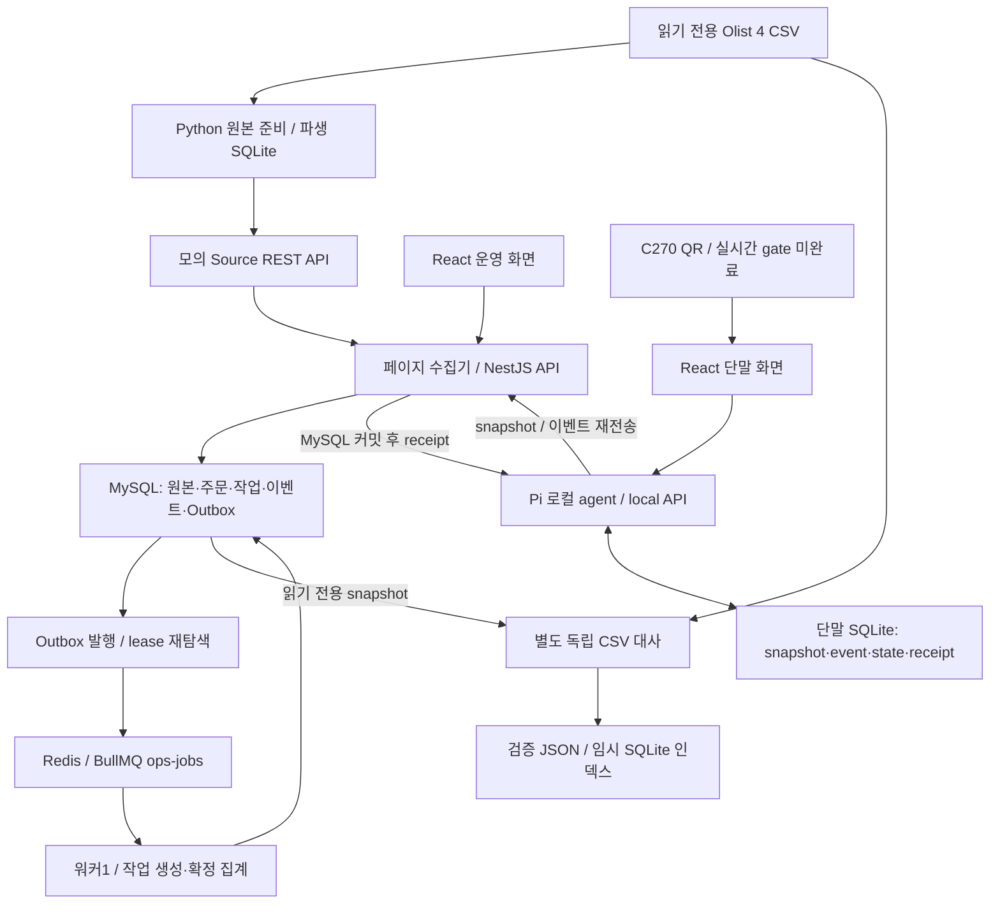
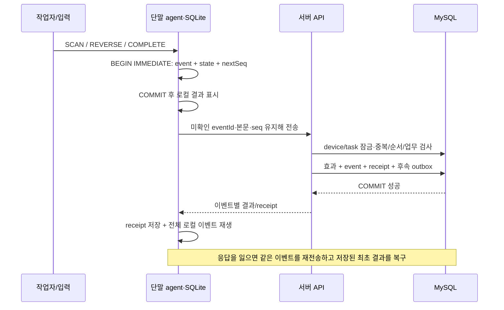

# 5~7. 설계·구현·의사결정

[개요](README.md) · [문제 해결](troubleshooting.md) · [검증/결과](verification-results.md)

## 5. 시스템 아키텍처

### 5.1 구성 요소와 실제 경계

도식의 카메라 경로는 코드에 구현되어 있지만 전체 광학 시연은 BLOCKED다.
사진 해독→검증 폼 입력 성공은 그 경로 전체의 PASS가 아니다.
[카메라 코드](../../web/camera.ts), [장비 결과](../../reports/hardware-validation.md)

| 구성 요소 | 실제 역할 | 구현 근거 |
|---|---|---|
| 원본 준비·Source | CSV 해시/행수/관계 보존, 읽기 전용 준비 SQLite에서 주문 페이지와 가상 공개 시각 생성 | [prepare-data.py](../../tools/prepare-data.py), [Source](../../src/source/source.ts) |
| API·수집기 | 외부 페이지 검증, 원본/정규화/checkpoint/outbox 저장, 운영 조회·배정·이벤트 처리 | [ingest](../../src/ingestion/ingest.ts), [API](../../src/operations/api.ts), [HTTP 어댑터](../../src/server/http.ts) |
| MySQL | 서버 업무 기록, 수량·상태·유일성·잠금, 이벤트별 receipt와 후속 job 보존 | [DB 트랜잭션](../../src/server/db.ts), [migration](../../migrations/001_initial.sql), [CHECK 제약](../../migrations/004_domain_checks.sql) |
| Redis/BullMQ·워커 | outbox ID를 전달받아 작업/집계 실행. 최종 완료 기준은 DB 상태 | [jobs](../../src/jobs/jobs.ts), [worker 시작점](../../src/server/worker-main.ts) |
| 단말 agent·React | loopback API를 통한 기록, snapshot/이벤트 보존·복구, 서버 동기화와 상태 표시 | [agent](../../src/device/main.ts), [LocalStore](../../src/device/store.ts), [Sync](../../src/device/sync.ts), [화면](../../web/main.tsx) |
| 검증 도구 | 원본 직접 파싱과 DB projection을 비교하는 별도 경로. 업무 처리 모듈과 정답을 공유하지 않도록 분리 | [CSV 오라클](../../tools/audit-source.ts), [파생 인덱스](../../tools/audit-source-index.ts), [기존 reconcile](../../tools/reconcile.ts) |

API와 워커는 같은 도메인 코드와 MySQL을 쓰는 **모듈형 모놀리스**의 별도 프로세스다.
Source는 외부 경계를 모의하기 위한 별도 서비스다. 실제 상용 외부 API 연동이나
마이크로서비스 운영 경험으로 표현하지 않는다. [ADR-02/03](../09_decisions_sources.md), [Compose](../../compose.yaml)

### 5.2 주문 수집과 작업 생성

1. 원본 CSV를 준비 인덱스에 보관하고, product/seller master를 서버에 적재한다.
   master 준비가 끝나기 전 수집은 거부한다. [masters](../../src/ingestion/masters.ts), [수집 guard](../../src/ingestion/ingest.ts)
2. Source의 cursor는 run·scenario hash·limit·offset을 담는다. run/limit/scenario가 달라지면
   거부하고, 고정 페이지가 모두 공개되기 전에는 같은 cursor의 대기 응답을 준다.
   인터페이스가 cursor라는 이유로 내부까지 keyset 조회라고 부르지 않는다. 실제 Source는
   SQLite LIMIT/OFFSET이다. [Source](../../src/source/source.ts), [시험](../../tests/source.test.ts)
3. `ingestPage`가 checkpoint를 잠그고 원본 동일성·정규화 결과·상품 수량·CREATE_TASK outbox·
   다음 checkpoint를 **한 MySQL 트랜잭션**에 기록한다. 중간 실패하면 함께 rollback한다.
   같은 원본 key/같은 hash는 재수집으로 처리하고 상충 본문은 source_conflicts에 보존한다.
   [수집 구현](../../src/ingestion/ingest.ts), [통합 시험](../../tests/integration/ingestion.test.ts)
4. dispatcher가 PENDING 또는 lease 만료 DISPATCHED를 Redis로 전달한다. 워커는 주문/job을
   잠그고 revision과 적격성을 확인한 뒤 작업을 만들고 outbox DONE을 함께 커밋한다.
   [작업 생성](../../src/fulfillment/tasks.ts), [작업 처리](../../src/jobs/jobs.ts)

### 5.3 단말 동기화와 확정

네트워크 전달은 중복될 수 있다. DB의 업무 효과가 한 번이 되도록 하는 설계이며 네트워크의
exactly-once 보장은 아니다. HTTP200도 배치의 모든 이벤트 성공을 의미하지 않는다.
[응답 계약](../04_api_sync_contract.md), [서버 적용](../../src/sync/events.ts)

## 6. 핵심 기능 및 구현

### 6.1 원본 사실과 업무 모델

`order_item_id`는 상품 행 식별자다. 필요 수량은 동일 주문·상품의 **행 수**로 계산한다.
필수값/관계 오류는 DATA_HOLD, 취소 등 미지원 상태·다중 판매자는 UNSUPPORTED,
정상 단일 판매자는 READY→TASK_CREATED다. 품질 오류를 삭제하거나 조용히 통과시키지 않는다.
품질 사유가 중첩되면 DATA_HOLD가 우선이며 quality flag는 별도로 보존한다.
[정규화 코드](../../src/ingestion/normalize.ts), [품질 플래그 생성](../../src/source/source.ts),
[정규화 시험](../../tests/normalization.test.ts), [전체 실제 분류 근거](../../reports/audit-memory-2026-10-29/legacy-current/reconciliation-e7fb6a95-0d26-42b5-9305-5b559569b7da.json)

서버 원본 payload와 CSV를 별도로 남긴다. DATA_HOLD 정정은 task 생성 전에만 허용하고
revision·사유·감사·이전 값을 보존한다. 실제 원본 주문을 수정하거나 실제 배송 변경 이벤트를
수집한 기능이 아니다. [운영 구현](../../src/operations/api.ts), [회귀](../../tests/integration/operations.test.ts)

### 6.2 작업 생성·배정·로컬 입력

작업은 order_id UNIQUE로 한 주문에 하나만 만든다. 최초 배정만 허용하며 snapshot에
task/run/device/assignmentVersion/requiredItems/hash를 고정한다. 같은 snapshot을 다시
받아도 로컬 이벤트를 초기화하지 않고, 같은 작업에 다른 hash가 오면 충돌로 차단한다.
[작업/배정](../../src/fulfillment/tasks.ts), [스냅샷 저장](../../src/device/store.ts), [시험](../../tests/integration/tasks.test.ts)

QR은 `LOPS1:PRODUCT:<productId>`라는 프로젝트 표식이다. 정상 입력마다 UUID와 작업별
연속 seq를 생성한다. 잘못된 형식/상품/초과는 로컬 정상 이벤트를 만들지 않는다. 취소는
기존 SCAN_ITEM의 eventId를 참조하고, 이미 취소된 스캔은 다시 취소할 수 없다. COMPLETE 후
로컬 입력은 잠근다. [LocalStore](../../src/device/store.ts), [로컬 시험](../../tests/local.test.ts)

### 6.3 이벤트 검증과 트랜잭션 경계

| 경계 | 같이 기록하는 것 | 실패/중복의 의미 |
|---|---|---|
| 단말 로컬 action | 이벤트·hash·seq·상태 projection, BEGIN IMMEDIATE→COMMIT | 중간 실패 시 일부 기록만 남지 않음. 시작 시 이벤트를 재생해 상태 복원 |
| 서버 이벤트 하나 | 수량/스캔·task 상태·lastProcessedSeq·event/receipt·완료 후 outbox | COMMIT promise가 성공한 뒤 결과 반환. Redis 성공 여부와 독립 |
| 단말 receipt 수용 | 이벤트 전송 상태/receipt·동기화 메타·상태 재생 | 오래된 receipt.appliedItems로 나중의 로컬 스캔을 덮지 않음 |
| 워커 job 하나 | 업무 변경·outbox DONE·시도 이력 | 재전달 시 DONE/UNIQUE/상태 검사로 이중 효과 차단 |

[로컬 코드](../../src/device/store.ts), [서버 코드](../../src/sync/events.ts),
[트랜잭션 wrapper](../../src/server/db.ts), [워커 코드](../../src/jobs/jobs.ts)

서버는 device/task를 잠근 뒤 **기존 이벤트를 terminal 상태 검사보다 먼저** 확인한다.
같은 `(deviceId,eventId)`/hash는 저장 receipt를 DUPLICATE로 반환하고, 본문 재사용은
EVENT_ID_REUSED로 차단한다. `(taskId,assignmentVersion,seq)`의 유일성과 다음 seq를 확인해
gap은 DEFERRED로 둔다. 올바른 형식·순서이지만 업무상 불가능하면 REJECTED receipt를
커밋하고 해당 seq를 소비하며 작업을 HOLD로 둔다. 다른 작업의 전송은 계속한다.
[이벤트 코드](../../src/sync/events.ts), [순서·소유권·중복 시험](../../tests/integration/sync.test.ts),
[업무 거부 시험](../../tests/integration/event-rules.test.ts)

COMMIT 보류 시험은 응답이 대기하고 별도 DB 연결에서 이벤트/효과가 안 보이는지 확인한다.
동시8전송은 APPLIED1/DUPLICATE7을 검증한다. 이는 ACK 경계를 실제로 확인한 시험이며
코드 주석이나 정상 HTTP 응답만으로 판정하지 않았다.
[시험 코드](../../tests/integration/commit-boundary.test.ts), [실행 로그](../../reports/independent-2026-10-28/commit-boundary.tap)

### 6.4 운영·관측·집계

운영 변경은 actor/requestId·본문 hash·응답을 보존한다. 재시도는 일시 오류의 실패 job에
허용하며 영구 오류/업무 충돌을 우회하는 ‘강제 성공’은 없다. 단말 pending은 마지막 관측값과
시각을 함께 보여 주고 stale을 표시한다. [운영 요청](../../src/operations/requests.ts), [운영 API](../../src/operations/api.ts)

보고서는 CONFIRMED만 업무 기준일·상품별로 재계산한다. 같은 날짜 재생성을 직렬화하고
파생 보고서만 교체한다. 완료 이벤트마다 별도 outbox dedupeKey를 만들어 같은 날의 나중
완료도 반영한다. DB 시계에서 마지막 기록 직전 얻은 UTC 확정 시각을 사용하며, 필드가 DB
로그의 정확한 commit timestamp라는 뜻은 아니다.
[집계](../../src/jobs/jobs.ts), [UTC 시계](../../src/sync/events.ts), [시계 시험](../../tests/integration/server-clock.test.ts)

### 6.5 API·DB 최소 참조

| 실제 endpoint | 역할 |
|---|---|
| `POST /api/v1/ingestion/runs`, `GET /source/v1/orders` | 수집 시작·모의 외부 주문 페이지 |
| `POST /api/v1/tasks/{taskId}/assignment` | 최초 배정·불변 스냅샷 |
| `GET /api/v1/device/tasks`, `POST /api/v1/device/events` | 소유 단말 다운로드·이벤트별 결과 |
| `POST /local/v1/tasks/{taskId}/scans`, `/reversals`, `/complete` | 로컬 이벤트 저장 |
| `GET /api/v1/jobs`, `POST /api/v1/jobs/{jobId}/retry` | 서버 후속 작업 관측·조건부 재시도 |
| `GET /api/v1/reports/daily`, `/api/v1/reports/daily.csv` | 확정 기준 집계·CSV |
| `GET /api/v1/ready` | MySQL 중단503, Redis 중단 degraded |

[OpenAPI 전체](../openapi.yaml)·[예시/known answers](../examples.json)·[HTTP 검증](../../src/server/http.ts).
서버 목록 최대200, 이벤트 배치 최대100, JSON body256KiB 제한이다.
원본의 document_checks.json은 **문서 검사 당시**27 operations를 기록하지만 현재 계약은
로컬 history/health 추가 후29 operations/44schemas다. [현재 문서 검사 로그](../../reports/audit-memory-2026-10-29/documents-final.txt)

DB 핵심 제약은 raw 원본 식별자 유일성, tasks.order_id UNIQUE, event 식별/순서 UNIQUE,
task_items의 수량 범위, 상태/소유권 CHECK다. 세부는
[001 schema](../../migrations/001_initial.sql), [004 CHECK](../../migrations/004_domain_checks.sql),
[DB 자체 제약 시험](../../tests/integration/constraints.test.ts)에 연결한다.

## 7. 주요 기술적 의사결정

‘대안’은 새로 구현·비교 실험한 항목이 아니라 **계약상 고려사항/선택하지 않은 경로**인 경우를 구분했다.
결정 주체의 개인별 판단 과정은 기록에 없으면 [기여 확인 목록](contribution-ai.md)에 남긴다.

| 문제 | 대안·고려사항·제약 | 선택 | 실제 결과·판단 근거 |
|---|---|---|---|
| 연결이 끊기면 스캔 기록을 유지해야 함 | 화면 메모리만으로는 프로세스 재시작 후 복구 불가. 다른 DB 제품 비교 기록은 없음 | 단말 파일 SQLite WAL/FULL, event/state 동시 트랜잭션·재생 | WSL 파일 DB SIGKILL 및 실제 Pi 정상 재부팅 PASS. 물리 SD 손상은 미시험. [ADR-04](../09_decisions_sources.md), [실제 재부팅](../../reports/hardware-2026-10-28/reboot.json) |
| 수신/큐 등록을 업무 확정으로 혼동할 위험 | 더 이른 ACK는 별도 durable inbox/최종 receipt 계약이 필요. 구현한 비교 대안은 아님 | MySQL 이벤트 효과/receipt 커밋 뒤 ACK | COMMIT 보류/실패·응답 유실 시험 PASS. Redis 장애 때도 DB가 정상이라면 적용 가능. [ACK 시험](../../tests/integration/commit-boundary.test.ts), [장애 결과](../../reports/audit-memory-2026-10-29/service-faults.json) |
| 최소1회 전달과 부분 배치 재시도 | Redis lock이나 전송 횟수 제한만으로 중복 영구 효과를 막지 않음 | 이벤트 ID/hash/seq·DB UNIQUE·행 잠금·중복 우선 검사 | 동시8요청1회 효과, 완료 ACK 유실도 기존 receipt 복구. device 잠금은 같은 단말 요청을 직렬화하며 확장 성능은 미측정. [서버 코드](../../src/sync/events.ts), [snapshot 시험](../../tests/integration/snapshot-lifecycle.test.ts) |
| DB 저장 후 Redis 전달이 실패할 위험 | DB와 Redis의 원자적 이중 쓰기를 전제할 수 없음 | 같은 DB 트랜잭션의 outbox, lease 만료 재발행, 멱등 워커 | Redis 중단·delivery 소실 후 작업1개 복구 PASS. outbox는 완료 판정까지 DB에 보존. [ADR-06/11](../09_decisions_sources.md), [Redis 시험](../../tests/integration/redis.test.ts) |
| 오프라인 동안 배정 의미가 변할 위험 | 자동 재배정은 소유권·버전·정정 정책이 필요 | 단말1·최초 수동 배정·불변 snapshot | 재배정/다른 소유자/버전 차단 PASS. 다중 단말 운영 완료가 아님. [ADR-08](../09_decisions_sources.md), [배정 코드](../../src/fulfillment/tasks.ts) |
| 완료 날짜가 단말 시계·전송 지연에 흔들릴 위험 | 단말 occurredAt은 관측값으로만 보존 | 서버 UTC 확정 기록 시각과 설정 업무 시간대 사용 | DB 세션 시간대 결함을 추가 수정하고 회귀 PASS. 현장 완료 날짜 리포트와는 의미가 다름. [ADR-09](../09_decisions_sources.md), [IV-01](troubleshooting.md#81-iv-01-확정-시각의-시간대-재해석--제품-결함) |
| 원본 전체가 JS 배열/Map에 남아 대사 RSS가 큼 | 원본 정렬을 가정한 병합은 비정렬·중복 대응 제약. SQLite 임시 인덱스는 I/O·저장 공간 필요 | 디스크 인덱스·200주문 관계 조회·master/event/집계 스트림 | 같은 데이터 3쌍에서 RSS 중앙50.21% 감소, 시간47.73% 증가·관측 임시 최대73.949MiB. 전체 서비스 메모리 절감 주장은 하지 않음. [측정/결정](../../reports/audit-memory-2026-10-29/README.md), [개선 커밋](https://github.com/leah-1ee/logistics-automation/commit/92d6ba5) |

독립 대사의 임시 SQLite는 8MiB cache 목표·mmap0·FILE 임시 저장이며 재생성 가능한
파생물만 journal/synchronous OFF다. 단말 WAL/FULL과 혼동하면 안 된다. 전체 CSV는 디스크에
놓되 한 주문의 상품과 현재 페이지의 관계 행은 메모리에 올리므로 임의 크기 입력의 상수 메모리
보장은 아니다. [구현](../../tools/audit-source-index.ts), [측정 한계](../../reports/audit-memory-2026-10-29/README.md)
